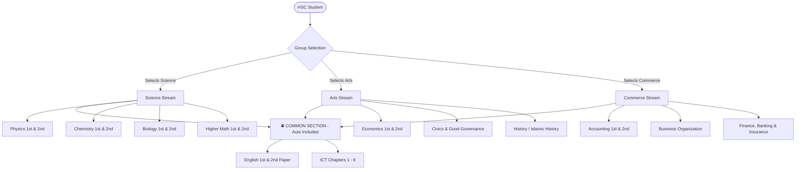

# 📚 Porua — Multi-Agent System Expansion & Implementation Plan
> **Tagline:** *"Knows where you're weak, plans what to study next, works offline."*  
> **Project Scope:** NCTB Board Exam Prep for HSC & SSC (Science, Arts, Commerce, Common)  
> **Document Version:** 2.1.0  
> **Target Release:** v1.1.0

---

## 🎯 Executive Summary & Core Objectives

This updated implementation plan incorporates the exact **20-Question Adaptive Session & Remedial Loop Architecture**. 

Porua acts as a personal intelligent study coach that:
1. **Delivers standard 20-MCQ practice sessions** with 4 options per question.
2. **Grades all 20 answers upon submission** locally without API cost.
3. **Rewards 100% Mastery** with an immediate "NEXT SESSION" progression path.
4. **Catches every mistake** and offers an intelligent dual-branch:
   - **`✦ Learn from Mistakes` (ভুল থেকে শেখো):** Gathers the exact categories of the failed questions and instantly generates a new **20-question targeted remedial session** (mixing failed questions + similar questions from those exact weak categories).
   - **`Skip` (স্কিপ):** Allows the learner to skip targeted remediation and proceed to the next session.
5. **Universal Curriculum:** Automatically includes the **Common Section (English 1st/2nd Paper & ICT)** for Science, Arts, and Commerce students.
6. **Zero-Leakage AI Key Management (BYOK):** In-app Settings UI for Gemini and Grok API keys stored securely in `DataStore`.

---

## 🔄 The 20-MCQ Practice & Remedial Loop Architecture

```mermaid
flowchart TD
    Start([User Taps Practice]) --> Session[20-MCQ Session Starts]
    Session --> Options[Each MCQ has 4 options: A, B, C, D]
    Options --> UserSelects[User Selects Answers]
    UserSelects --> SubmitBtn[User Taps Submit Button]
    SubmitBtn --> Evaluation{Backend Evaluation}

    Evaluation -->|Score = 100% (20/20)| Perfect[🎉 100% Mastery Celebration]
    Perfect --> NextBtn[Button: 'NEXT SESSION']
    NextBtn --> NextSession[Unlock & Advance to Next Chapter/Session]

    Evaluation -->|Mistakes Detected (e.g. 5 Wrong)| FailureReport[Result: Score 15/20, 5 Mistakes Tagged with Categories]
    FailureReport --> Decision{User Choice}

    Decision -->|Taps 'Learn from Mistakes'| RemedialEngine[Targeted Remedial Engine]
    RemedialEngine --> Collect[Gather categories of the 5 failed questions]
    Collect --> Generate20[Generate 20-Question Targeted Session:<br/>• 5 Failed Questions for Review<br/>• 15 Similar Questions from Failed Categories]
    Generate20 --> Session

    Decision -->|Taps 'Skip'| SkipBtn[Skip Remediation]
    SkipBtn --> NextSession
```

---

## 🔬 Deep-Dive: Adaptive Remedial Session Generation Logic

### 1. The 20-Question Session Contract
* Every practice session always presents exactly **20 MCQs**.
* Each MCQ displays 4 radio options ($A, B, C, D$).
* Questions remain navigable; the user can review and change answers before tapping the primary **`SUBMIT`** button at the bottom.

### 2. Case 1: 100% Correct (20/20)
* Instant feedback: Congratulatory banner (`100% Perfect Score! Mastery +15%`).
* SM-2 repetition schedule updates all 20 items to interval `EASY` (+4 days).
* The primary action button changes to **`NEXT SESSION`** (পরবর্তী সেশন), loading the subsequent chapter or mixed challenge.

### 3. Case 2: Mistakes Detected (e.g., $k = 5$ Wrong Answers)
* Result screen shows detailed score (e.g., $15/20$) with category breakdown.
* The system identifies the category/topic tag for each of the 5 missed questions (e.g., *Chemistry Ch 3: Alcohols, Electrolysis*).
* Two explicit action paths are surfaced:
  1. **Primary Button: `✦ Learn from Mistakes (ভুল থেকে শেখো)`**
     - Triggers `startRemedialSession(failedQuestions, weakCategories)` in `QuizViewModel`.
     - The engine builds a fresh **20-question session**:
       - **$k$ questions (e.g., 5):** The exact questions the student missed (resurfaced for immediate reinforcement).
       - **$20 - k$ questions (e.g., 15):** Pulled from the JSON question bank matching the *exact weak categories* of the missed questions.
     - The student repeats until all conceptual traps are mastered.
     - **Cost:** \$0.00 (100% on-device SQLite/Room querying).
  2. **Secondary Button: `Skip (স্কিপ)`**
     - Bypasses category remediation and advances to the next standard session.
     - The 5 mistakes remain logged in the Room DB weak-topic map for future scheduled reviews.

---

## 🏛️ Curriculum & Content Architecture



---

## 👥 Multi-Agent Division of Labor (6 Specialized Agents)

| Agent ID & Role | Domain Ownership | Primary Responsibilities |
| :--- | :--- | :--- |
| **Agent 1: Science & Common Content Architect** | `assets/common/` & `assets/science/` | Authors complete English & ICT JSON question banks (20-50 MCQs/ch with topic tags); expands Science JSONs. |
| **Agent 2: Arts & Commerce Specialist** | `assets/arts/` & `assets/commerce/` | Authors Accounting, Business Org, Economics, Civics JSON assets with fine-grained topic tags. |
| **Agent 3: Adaptive Learning Engine Developer** | `ui/viewmodel/QuizViewModel`, `QuizScreen`, `QuizResultScreen` | Implements the **Submit ➔ 100% Next ➔ Learn from Mistakes (20-MCQ remedial) vs Skip** state machine. |
| **Agent 4: AI & Security Integration Specialist** | `data/auth/`, `data/ai/`, `ui/screens/MeScreen` | Builds in-app Settings UI for Gemini & Grok API keys (BYOK), persists in `AuthDataStore`, wires `AiHelper`. |
| **Agent 5: Codebase Supervisor & Quality Assurance** | Build, Test & CI/CD Pipeline | Ensures JSON schemas are valid, verifies Room DB migrations, and tests offline remedial generation. |
| **Agent 6: Prompt & Continuous Improvement Lead** | AI System Prompts & Feedback | Authors NCTB-contextualized prompts for "Explain Why I'm Wrong" when students request on-demand AI tutor hints. |

---

## 🛠️ Step-by-Step Implementation Roadmap

### Phase 1: Adaptive 20-MCQ Session & Remedial Loop Engine (Agent 3)
1. **`QuizScreen.kt` Update:**
   - Ensure all 20 questions can be answered with a persistent bottom bar containing the **`Submit Session`** button.
2. **`QuizViewModel.kt` State Machine:**
   ```kotlin
   fun submitQuiz() {
       val result = evaluateAnswers()
       if (result.score == result.totalQuestions) {
           _uiState.update { it.copy(isPerfectMastery = true, showNextButton = true) }
       } else {
           val wrongQuestions = result.reviewItems.filter { !it.isCorrect }.map { it.question }
           val weakTopics = wrongQuestions.map { it.chapterTitle }.toSet()
           _uiState.update { it.copy(
               wrongQuestions = wrongQuestions,
               weakTopics = weakTopics,
               showRemedialOption = true,
               showSkipButton = true
           )}
       }
   }
   
   fun startLearnFromMistakesSession() {
       val weakTopics = _uiState.value.weakTopics
       val wrongQuestions = _uiState.value.wrongQuestions
       // Pool 20 questions: Wrong questions first + similar questions matching weakTopics
       val remedialSet = ContentRepository.getRemedialPool(wrongQuestions, weakTopics, targetCount = 20)
       startQuiz(remedialSet)
   }
   ```
3. **`QuizResultScreen.kt` UI Enhancements:**
   - 100% Score ➔ Large green celebration badge + **`NEXT SESSION`** button.
   - Mistakes ➔ Clear score card + **`✦ Learn from Mistakes (ভুল থেকে শেখো)`** primary button + **`Skip (স্কিপ)`** secondary button.

### Phase 2: Common Section (English & ICT) & Science Expansion (Agent 1)
1. Author `app/src/main/assets/common/ict.json` (Chapters 1 to 6, 20–50 MCQs/ch with topic tags).
2. Author `app/src/main/assets/common/english.json` (Grammar & Comprehension, 20–50 MCQs/ch).
3. Expand `science/` JSON files to ensure each chapter has sufficient MCQs to support both standard and remedial 20-question pools.
4. Update `ContentRepository.kt` to merge Common subjects with any selected stream.

### Phase 3: Arts & Commerce Question Banks (Agent 2)
1. Author `commerce/accounting.json`, `commerce/business_organization.json`, `commerce/finance_banking.json`.
2. Author `arts/economics.json`, `arts/civics.json`, `arts/history.json`.
3. Verify all JSONs comply with `ContentParser.kt`.

### Phase 4: BYOK Settings UI for Gemini & Grok (Agent 4)
1. Add "AI Model & API Keys" card in `MeScreen.kt`.
2. Add `geminiApiKey` and `grokApiKey` state flows in `AuthDataStore.kt`.
3. Update `AiHelper.kt` to dynamically read from `AuthDataStore` (fallback to `BuildConfig`).

### Phase 5: Verification, Testing & GitHub Release v1.1.0 (Agent 5 & 6)
1. Run offline test: Enter quiz ➔ answer 15/20 ➔ tap "Learn from Mistakes" ➔ verify new 20-question session is generated with failed items and similar topics.
2. Run 100% test: Answer 20/20 ➔ verify "NEXT" button advances properly.
3. Build release APK and publish to GitHub Releases via Actions.

---

## 🔒 Security & Privacy Standard
- **Zero API Key Leakage:** Keys are stored exclusively on the user's local device inside Android DataStore (`EncryptedSharedPreferences` / DataStore Preferences).
- **100% Offline Core:** Question banks, Spaced Repetition algorithms, and Weakness Tracking execute locally on SQLite without network calls.
